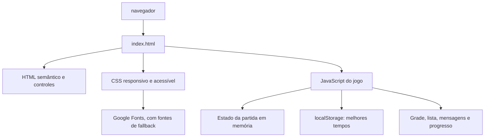

# Projeto técnico: Caça-palavras Intervalo

## 1. Objetivo

Este documento descreve a arquitetura e as decisões técnicas do Caça-palavras Intervalo. O sistema é uma aplicação web estática de página única. O documento registra o estado atual e as restrições para mudanças futuras; requisitos de produto e regras detalhadas estão em `PRD.md` e `ESPECIFICACOES.md`.

## 2. Arquitetura atual



As responsabilidades são separadas conceitualmente, mas permanecem no mesmo arquivo:

- **HTML:** estrutura, seletores, botões, grade, estado, mensagem, progresso e lista de palavras.
- **CSS:** identidade visual, disposição da página, estados das células, comportamento responsivo e suporte a movimento reduzido.
- **JavaScript:** configuração dos temas e níveis, geração da partida, renderização, interação, cronômetro e persistência de recordes.
- **Armazenamento do navegador:** mantém somente o melhor tempo de cada combinação de tema e dificuldade.

Não há servidor de aplicação, API, banco de dados remoto, framework ou dependências JavaScript.

## 3. Estrutura do repositório

```text
index.html             Entrada executável; contém HTML, CSS e JavaScript
README.md              Identificação básica do projeto
AGENTS.md              Orientações para alterações no repositório
PRD.md                 Objetivos e requisitos do produto
ESPECIFICACOES.md      Regras detalhadas de conteúdo e comportamento
PROJETO_TECNICO.md     Arquitetura e decisões técnicas
```

Manter a aplicação abrível diretamente como arquivo HTML. Novos arquivos de documentação não exigem alteração do runtime. Separar HTML, CSS ou JavaScript, ou introduzir build e dependências, requer uma necessidade explícita e atualização das instruções de execução.

## 4. Componentes lógicos

### Configuração

O objeto `themes` contém quatro bancos de palavras, e `settings` associa cada nível ao tamanho da grade e à quantidade de palavras. `directions` define os oito vetores permitidos; `alphabet` define letras usadas nas células livres.

### Geração

`createGame` seleciona as palavras do tema conforme a dificuldade, ordena-as por tamanho decrescente e tenta posicioná-las em uma grade vazia. `canPlace` verifica limites e conflitos. Células restantes recebem letras aleatórias antes da renderização.

### Renderização e interação

`render` cria um botão por célula, configura a grade e atualiza a lista de palavras. `chooseCell` coordena a seleção em duas etapas; `getLine` valida a geometria da seleção e forma a sequência de letras. `updateBoardStyles` reaplica os estados visuais de seleção e acerto. `updateProgress` atualiza contador, barra e atributos ARIA.

### Tempo e persistência

`updateTimer` calcula o tempo decorrido a partir de `startedAt`; um intervalo de um segundo atualiza a exibição. `finishGame` encerra a partida e persiste o recorde quando aplicável. `updateBestTime` lê a chave do tema e dificuldade ativos.

## 5. Fluxo de execução

1. O navegador carrega o documento e os estilos embutidos.
2. O script obtém referências aos elementos da página e registra os eventos dos controles.
3. `createGame` gera o estado inicial e `render` materializa grade e lista.
4. Eventos de célula atualizam seleção, mensagens, acertos e progresso.
5. Ao encontrar todas as palavras, o jogo interrompe a atualização do cronômetro e atualiza o recorde local.
6. Mudanças de tema/dificuldade iniciam outra partida e carregam o recorde correspondente.

## 6. Modelo de dados em runtime

O estado `game` contém:

| Campo | Tipo conceitual | Uso |
| --- | --- | --- |
| `size` | número | Número de linhas e colunas da grade. |
| `grid` | matriz de letras | Conteúdo exibido nas células. |
| `words` | lista de textos | Palavras efetivamente posicionadas e válidas para a partida. |
| `placements` | mapa de palavra para coordenadas | Origem da dica e destaque das células encontradas. |
| `found` | conjunto de textos | Palavras já encontradas, sem duplicação. |
| `selectedStart` | coordenada ou nulo | Primeira célula escolhida pela pessoa. |
| `startedAt` | timestamp | Base para cálculo do tempo decorrido. |
| `elapsed` | número de segundos | Tempo calculado da partida. |
| `finished` | booleano | Bloqueia novas seleções após conclusão. |

Não há necessidade de transferir o estado da partida para um servidor. Recarregar a página inicia uma partida nova; somente os recordes são persistidos.

## 7. Decisões e restrições técnicas

- **Página única:** reduz setup e permite distribuição simples; mudanças devem preservar o funcionamento sem build.
- **DOM nativo:** os controles são elementos HTML, e a grade é construída com APIs padrão do navegador.
- **Estado em memória:** partidas não são restauradas após recarregar ou fechar a página.
- **Persistência local:** recordes são isolados por tema e nível com chaves `intervalo-best-{tema}-{dificuldade}` e valores em segundos.
- **Sem dependência obrigatória de rede:** as fontes personalizadas vêm do Google Fonts; se a solicitação externa falhar, as fontes genéricas definidas no CSS continuam disponíveis.
- **Acessibilidade e responsividade:** manter nomes ARIA, região `aria-live`, foco visível, células dimensionadas de forma estável, breakpoints existentes e `prefers-reduced-motion`.

## 8. Execução e publicação

Para desenvolvimento ou uso local, abrir `index.html` em um navegador moderno. Como não existe processo de build ou backend, a publicação pode servir os arquivos estáticos em qualquer hospedagem compatível; não há configuração de hospedagem ou pipeline neste repositório.

Os recordes dependem do `localStorage` do navegador e da origem usada para abrir a página. O comportamento pode variar quando o armazenamento estiver bloqueado ou quando o arquivo for aberto diretamente, pois o suporte a armazenamento em URLs `file:` varia entre navegadores. A implementação atual não possui tratamento específico para falhas de acesso ao armazenamento.

## 9. Limitações e riscos conhecidos

- A geração tenta no máximo 400 posições aleatórias para cada palavra. Se não conseguir posicionar uma palavra, ela é excluída da lista ativa; portanto, a quantidade real pode ficar abaixo da configuração da dificuldade.
- O posicionamento aleatório não usa uma estratégia de retrocesso para reorganizar palavras já colocadas.
- O acesso a `localStorage` não está protegido contra exceções de ambiente ou armazenamento indisponível.
- Não existe uma matriz formal de navegadores suportados nem testes automatizados configurados.
- As fontes hospedadas externamente podem não carregar sem conexão; isso não deve impedir o jogo.

Ao corrigir uma limitação, atualizar este documento e `ESPECIFICACOES.md` para refletir o novo comportamento. Não alterar regras de jogo ou dependências como parte de uma mudança não relacionada.

## 10. Verificação técnica

Não há comando de build, lint ou suíte de testes automatizados no repositório. A validação deve ser manual no navegador, cobrindo os fluxos descritos em `ESPECIFICACOES.md`; verificar também abertura direta, tela estreita e comportamento quando fontes externas não estão disponíveis.